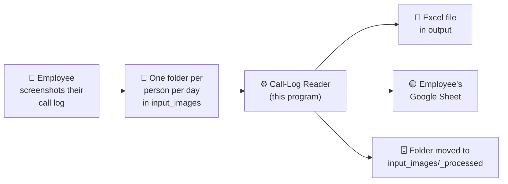

# Call-Log Reader

Turns photos and screenshots of employees' phone call logs into a daily
time sheet: **how long each person spent on calls, and when they started**. It
writes the result to an Excel file and to that person's Google Sheet.

It runs on one Windows computer and reads the pictures itself. Nobody has to
type the calls in by hand.

---

## The big picture



1. **Employees send screenshots** of their phone's call history for the day.
2. **You put them in a folder** named after the person and the date, for
   example `Nguyen Van A & 2026-06-01`.
3. **You run the program.** It reads every picture, finds each call's time and
   length, and groups calls that are close together into **sessions** (blocks
   of calling time).
4. **It writes the results** to an Excel file on this computer, and to a new
   tab for that date in the person's Google Sheet.
5. **It tidies up.** The folder is moved to an archive (`_processed`), but only
   after both results were saved successfully.

---

## What each part does

You never need to open these files to use the system. This is what they do,
in the order the work flows.

### Inside the program

| Step | Part | In plain words |
|---|---|---|
| 1 | **Picture clean-up** (`image_preprocess.py`) | Works out whether a picture is a screenshot or a photo of a phone. Photos are straightened, cropped to the screen, and sharpened so the text is easier to read. |
| 2 | **Text reader** (`ocr.py`) | "Reads" the picture the way a person would and turns it into lines of text. This uses an OCR engine (PaddleOCR) that understands Japanese, English and Vietnamese. |
| 3 | **Call finder** (`parser.py`) | Looks at each line and picks out the call's start time, its length, and whether it was outgoing, incoming or missed. It ignores phone numbers, the clock at the top of the screen, and advert banners. |
| 4 | **Session builder** (`session_builder.py`) | Removes calls that appear twice (screenshots overlap), puts the calls in time order, and joins calls that are close together into sessions. |
| 5 | **Excel writer** (`excel_writer.py`) | Fills in a copy of the day-sheet template (`sprs.xlsx`) and saves it in `output`. |
| 6 | **Google Sheets sender** (`sheets_sync.py`) | Sends the day's sessions to the Google side (below). |
| — | **Control centre** (`main.py`) | Runs steps 1–6 for each folder, then archives the folder. |
| — | **Settings** (`config.py`) | Every adjustable rule and number lives here: gap lengths, rounding, Google Sheets on/off. |

### On the Google side

| Part | In plain words |
|---|---|
| **Web App** (`apps_script/WebAppSync.gs`) | A small program that lives in Google's cloud, under the owner's Google account. It receives the day's sessions and edits the right spreadsheet: it creates the date tab from the `📄 Mẫu` template, fills it in, and adds the `Mở->` link in the month tab. The program on this computer never holds a Google password. It only knows the Web App's address and a shared secret word. |
| **Employee list** (`apps_script/Employees.gs`, private) | Which name belongs to which Google Sheet. Kept off GitHub. |

### Helper tools

| Tool | When to use it |
|---|---|
| `resync_output.py` | Re-send Excel results that already exist to Google Sheets, without reading the pictures again (for example, after the internet was down). |
| `diagnose.py` | A folder gave no sessions or strange results: shows exactly what was read from one picture and why each line was accepted or rejected. |
| `create_template.py` | Rebuilds a blank `sprs.xlsx` template. |
| `tools/check_private_data.py` | Checks that nothing private would be published if the code is uploaded to GitHub. |
| `tools/bake_models.py` | Checks that this computer's OCR models are exactly the ones the AWS version uses (`--check`). |
| `tools/gen_synth.py` / `tools/check_synth.py` | Make a set of made-up screenshots with known answers, then check that the program still reads every call correctly. Safe to share: no real names or numbers. |
| `tests.py` / `run_tests.py` | Automatic checks that the counting rules still work after a change. |

### Folders

| Folder | What's in it |
|---|---|
| `input_images/` | New work: one sub-folder per person per day. |
| `input_images/_processed/` | Finished folders. Kept for 30 days, then deleted automatically. |
| `output/` | The Excel results, one per person per day. |
| `apps_script/` | The Google-side program and its setup guide. |
| `docs/` | The detailed technical reference. |

---

## Daily use

### 1. Make one folder per person per day

Inside `input_images`, create a folder named **`<Name> & <yyyy-mm-dd>`**:

```
input_images/
├── Nguyen Van A & 2026-06-01/
│   ├── screenshot1.jpg
│   └── screenshot2.jpg
└── Tran Thi B & 2026-06-01/
    └── ...
```

- The **name** must start the same way as the name registered for that person
  (accents and capital letters don't matter). It decides whose Google Sheet the
  results go to, so a typo sends nothing, and a wrong name sends results to the
  wrong person.
- The **date** must be year-month-day with dashes.
- Up to 40 pictures per folder. Accepted: `.jpg`, `.png`, `.webp`, `.bmp`.
  **Not accepted:** iPhone `.heic`. Ask the sender to share as JPG.

### 2. Run the program

Open PowerShell in the `calls-log` folder and run:

```powershell
.\.venv\Scripts\python.exe main.py --images ./input_images --output ./output --template ./sprs.xlsx --batch --debug
```

The first run of the day takes 10–20 seconds to start, then a few seconds per
picture.

### 3. Check what happened

For each folder, look for these three signs of success:

1. a file `output/<Name> & <date>.xlsx` exists;
2. the log says `synced to Google Sheets`;
3. the folder has moved to `input_images/_processed/`.

**A folder that stays in `input_images` did not finish.** Its Excel file may
exist, but something stopped the Google Sheets step, or no calls were found.
Read the error in the log (see *When something goes wrong*), fix it, and run
the same command again. Only unfinished folders are processed again.

> ⚠️ **Re-running a date replaces that date's Google Sheets tab.** If someone
> corrected a day by hand in Google Sheets, those corrections will be
> overwritten. To avoid that, turn the Google step off first: set
> `sheets_sync_enabled = False` in `config.py`.

---

## How call time is counted

These are the rules the program follows. All the numbers can be changed in
`config.py`.

- **Which calls count:** every outgoing call (even unanswered or 0 seconds),
  and every answered incoming call. Missed incoming calls do not count.
- **Rounding:** each call is rounded to whole minutes. 20 seconds or more
  rounds up, less rounds down (1 min 25 s → 2 min; 1 min 15 s → 1 min).
- **Sessions:** calls with a gap of **5 minutes or less** between them form one
  session.
- **After 09:00 exception:** after 9 AM, a gap of up to **10 minutes** still
  joins the session, but only **4 times per day** (first come, first served).
- **A session's length** is from the start of its first call to the end of its
  last call, including the short gaps.
- **The day sheet shows:** each session's start, end and length (rows 7–22),
  the **total** (B2), and the **first start time** (B3). B4 (attendance note)
  is left for a person to fill in.

---

## Tips for employees taking screenshots

1. **Screenshots are better than photos.** If the phone can take a screenshot,
   use one.
2. Capture the **whole day**, from the top of the list down to the first call
   of the morning, with a little overlap between pictures. Duplicates are
   removed automatically, but gaps can't be recovered.
3. **Stop at the `昨日` (yesterday) line.** Anything below it would be counted
   as today.
4. Don't crop, draw on, or resize the pictures.
5. If you must photograph the screen: the whole screen in the frame, a dark
   background, no glare, held fairly straight and the right way up (an
   upside-down photo gives no calls).

A day that comes out suspiciously short is almost always **missing pictures**,
not a reading error. Check how many images were sent first.

---

## When something goes wrong

| What you see | What it means | What to do |
|---|---|---|
| `unknown name` | The folder name doesn't match any registered person. | Check the spelling of the folder name. If it's a new employee, see *Adding a new employee*. |
| `bad secret` | The secret word on this computer and in the Google Web App don't match. | The person who set up the system needs to make them identical. |
| `Web App request failed` / timeout | No connection to Google. | Check the internet connection and run again. |
| `no sessions extracted` | The pictures were read but no calls were found. | Run `diagnose.py` on one picture (see `docs/TECHNICAL.md`), or check that the pictures show the call list. |
| Times off by 12 hours | AM/PM couldn't be read on a picture. | Check that picture; fix the time in the sheet by hand. |
| An early or late session that looks wrong | Yesterday's calls were included. | Check whether a screenshot went past the `昨日` line. |
| `KeyboardInterrupt` when nobody pressed anything | A known technical clash between two OCR libraries. | See `docs/TECHNICAL.md` → Troubleshooting. |

---

## Adding a new employee

No change to this program is needed. The person who manages the Google Web App:

1. adds the person's name and Google Sheet ID to the employee list in the
   Google Apps Script project (and in the local private `Employees.gs`);
2. publishes it as a **new version of the existing deployment** (never a "new
   deployment", which changes the Web App's address).

Exact steps are in [`apps_script/README_SETUP.md`](apps_script/README_SETUP.md).
From then on, folders named after that person go to their sheet.

---

## Privacy: what never leaves this computer

The pictures contain **customers' phone numbers and employees' call history**,
and the results are employees' working hours. Together with the Google
access details, none of this may be uploaded to GitHub. The project is set up
to keep it out automatically:

| Kept private | Why |
|---|---|
| `input_images/`, `output/`, any picture or Excel file (except the blank template `sprs.xlsx`) | Employee and customer data |
| `secrets_local.py` | The Web App's address and secret word: together they can write to every employee's sheet |
| `apps_script/Employees.gs` | Employee names and their Google Sheet IDs |

Before uploading the code anywhere, run:

```powershell
.\.venv\Scripts\python.exe -X utf8 tools\check_private_data.py
```

It must say `OK`. To have this check run automatically before every commit and
upload, run once: `git config core.hooksPath .githooks`.

---

## First-time setup (for whoever installs it)

1. Install **Python 3.13** (64-bit).
2. In the `calls-log` folder:
   ```powershell
   python -m venv .venv
   .\.venv\Scripts\python.exe -m pip install --require-hashes -r requirements.lock
   copy secrets_local.example.py secrets_local.py
   ```
   `requirements.lock` pins the exact, checked versions, so every computer
   reads the pictures the same way. Moving an existing install to it: delete
   the old `.venv` folder first and repeat this step, because installing over
   an old venv keeps its extra packages.
3. Fill in `secrets_local.py` with the Web App address and secret word (see
   `apps_script/README_SETUP.md`).
4. Check everything works (no pictures needed):
   ```powershell
   .\.venv\Scripts\python.exe -X utf8 run_tests.py
   ```
   The last line should say `0 failed`.

The first real run downloads the OCR models (about 200 MB), so it needs
internet. After that it works offline, apart from the Google Sheets step.

---

## Glossary

| Word | Meaning |
|---|---|
| **OCR** | "Optical character recognition": software that reads text out of a picture. |
| **Session** | A block of calling time: calls close enough together to count as one stretch of work. |
| **Batch** | One run of the program over every folder waiting in `input_images`. |
| **Template** (`sprs.xlsx` / `📄 Mẫu`) | The blank day sheet that each result is copied from. |
| **Web App** | The small Google-side program that writes into the Google Sheets. |
| **Deployment** | The published, live version of the Web App. Saving changes doesn't affect it until a new version is published. |
| **Sync** | Sending the day's results to Google Sheets. |

## More detail

- [`docs/TECHNICAL.md`](docs/TECHNICAL.md): every setting, exact rules,
  troubleshooting, known limitations, and how the Google side works.
- [`apps_script/README_SETUP.md`](apps_script/README_SETUP.md): setting up or
  updating the Google Web App.
