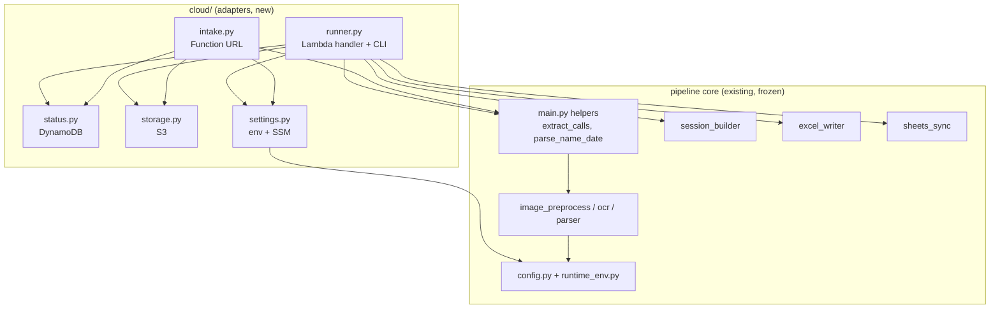
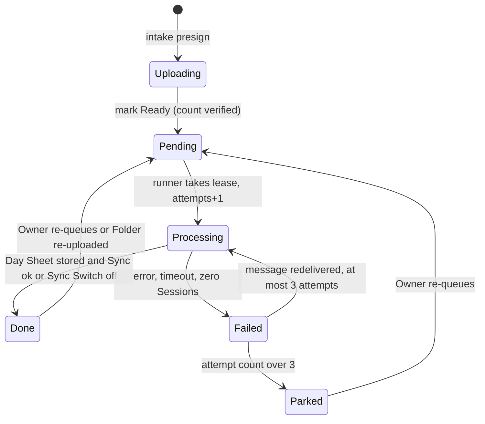
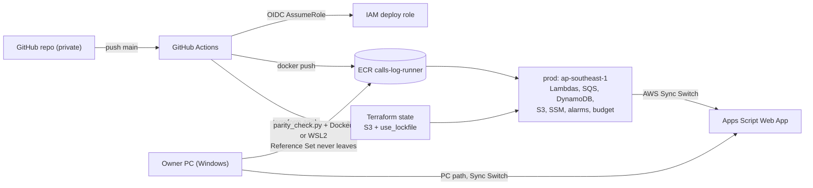

# Architecture Spine: calls-log on AWS

## Design Paradigm

**Hexagonal (ports and adapters) around a frozen pipes-and-filters core.** The existing pipeline
(`image_preprocess → ocr → parser → session_builder → excel_writer → sheets_sync`) is the domain
core and is reused, never rewritten. Everything AWS-specific is an adapter in `cloud/`. Work
arrives through a queue, one Folder per message, so the load is levelled and concurrency is
bounded.



Dependencies point **only from `cloud/` into the core**. The core never imports `cloud/` (AD-1).

## Invariants & Rules

### AD-1: The pipeline core is frozen and shared [ADOPTED]
- **Binds:** all units; FR-4, NFR-8
- **Prevents:** PC and AWS producing different results because one side forked the logic.
- **Rule:**
  - `cloud/` may import `main`, `image_preprocess`, `ocr`, `parser`, `session_builder`,
    `excel_writer`, `sheets_sync`, `config`. Nothing in the core imports `cloud/`.
  - Pipeline behaviour changes only by changing the core, which then applies to both the PC and
    AWS.
  - `import runtime_env` stays first in every entrypoint, including `cloud/runner.py`.
  - A test fails if any core module imports `cloud`.

### AD-2: One Run = one Ready Folder, in one process, sorted image order
- **Binds:** runner; FR-4, FR-6
- **Prevents:** dedupe "keep first" order drift, and split-brain aggregation.
- **Rule:**
  - A Run processes all images of one Folder in the order `gather_jpg_files` uses (sorted names),
    then calls `dedupe → build_sessions → write_sessions → sync_day` once.
  - No per-image fan-out across processes.

### AD-3: One pinned runtime for the PC and AWS [ADOPTED]
- **Binds:** runner image, PC venv, CI; FR-25, NFR-8
- **Prevents:** OCR model or version drift between the systems that may both write.
- **Rule:**
  - One hashed `requirements.lock`, generated from the production PC's `pip freeze`, installs both
    the PC and the image.
  - Python 3.13, x86_64 only (paddlepaddle has no aarch64 cp313 wheel).
  - OCR models are baked into the image with recorded SHA-256 sums, and no model is downloaded at
    run time.
  - Changing the lockfile or the models requires FR-26 to pass.

### AD-4: The Folder Status record owns the lifecycle
- **Binds:** intake, runner, status page; FR-9, FR-10, FR-15
- **Prevents:** two owners of state, and half-moved "archive" states in S3.
- **Rule:**
  - The DynamoDB item for an upload is the only source of truth for its Folder Status.
  - Only `cloud/status.py` writes it, and every transition is a conditional update from the
    expected prior state (diagram below).
  - S3 objects are never moved, renamed or deleted to signal state. Lifecycle rules do retention.

### AD-5: Single-flight per Person-Day
- **Binds:** runner; FR-6
- **Prevents:** concurrent Runs for one Person-Day creating duplicate day tabs, or overwriting each
  other's output.
- **Rule:**
  - Before work starts, the runner takes a conditional lease on the Person-Day item, with expiry
    set to now plus 1,000 s (longer than the 900 s timeout).
  - If the lease is held, the message is returned unprocessed.
  - The Person-Day key is the NFC-normalised `<Name> & yyyy-mm-dd` (AD-8).

### AD-6: Attempts are counted at Run start; 3 means Parked
- **Binds:** runner, queue; FR-10, FR-18
- **Prevents:** unbounded retries, and throttles or timeouts that escape the count.
- **Rule:**
  - The runner takes the AD-5 lease first. A lease miss is not an attempt.
  - Holding the lease, it increments `attempts` conditionally *before* processing, so timeouts are
    counted.
  - When `attempts > 3`, the runner marks the Folder `Parked`, publishes the alert, and deletes the
    message.
  - The SQS dead-letter queue (`maxReceiveCount` 10) is a crash backstop only, and it alarms.

### AD-7: Commit order matches `main.py`
- **Binds:** runner; FR-8, FR-9
- **Prevents:** a Folder marked Done without its Day Sheet or its Sync.
- **Rule:**
  - Zero Sessions ends the Run as `Failed`, without writing a Day Sheet.
  - Otherwise: store the Day Sheet → if the AWS Sync Switch is on, `sync_day` (unchanged; 3 tries)
    → `Done`.
  - Any exception leaves the Folder `Failed` and lets the message return.

### AD-8: Keys and names
- **Binds:** intake, runner, resync, import; FR-6, FR-11, FR-13, FR-14
- **Prevents:** NFC/NFD duplicates, `(n)` races, and ad-hoc key layouts.
- **Rule:**
  - `inbox/<uploadId>/<original file name>`
  - `work/<uploadId>/<file name>.json` (checkpoints)
  - `results/<Person-Day>.xlsx`, with bucket versioning instead of `(n)` copies
  - `uploadId` is `<UTC yyyymmddTHHMMSSZ>-<8 random hex>` (standard library only).
  - Person-Day is the NFC form of the folder name, with name and date taken from
    `main.parse_name_date` plus calendar validation.
  - Allowlist matching uses the same fold as `norm_()` in `WebAppSync.gs`.
  - **One implementation:** `cloud/naming.py` does all name parsing, validation, normalisation and
    allowlist matching. Intake, runner, resync and import call it; nothing else parses folder
    names.
  - The one-off import (FR-14) uploads every `(n)` copy as a version. The **current** version is the
    file `resync_output.collect_files` would select (the base file when present), so AWS resync
    sends what PC resync sends.

### AD-9: Configuration and secrets
- **Binds:** settings, `config.py`, Terraform; FR-19, VG-04, VG-05
- **Prevents:** secrets in the image, repo or Terraform state, and env parsing that flips the
  load-bearing flags.
- **Rule:**
  - AWS values come from env vars set by Terraform (names, ARNs, sizes) and from SSM SecureString
    read once per container.
  - `config.py` gains env overrides, with `secrets_local.py` as the PC fallback.
  - `ocr_strict_engine`, `paddle_enable_mkldnn` and `post_9am_exception_limit` are **not**
    overridable.
  - `cloud/settings.py` is the only reader of `CALLS_LOG_*` variables and SSM. Terraform builds the
    function environment from one `locals` map whose keys match `settings.py`.
  - The runtime sets `PADDLE_PDX_CACHE_HOME=/tmp/paddlex` (baked models copied there at cold start)
    and `PADDLE_PDX_DISABLE_MODEL_SOURCE_CHECK=True`.
  - Terraform creates the SSM parameters with `ignore_changes = [value]`. The real values are set
    out-of-band.

### AD-10: Independent Sync Switches
- **Binds:** runner, PC; FR-29, FR-30
- **Prevents:** a coupled switch that stops the Owner choosing PC, AWS or both.
- **Rule:**
  - AWS reads `/calls-log/sync_enabled` at the start of each Run.
  - The PC keeps `CONFIG.sheets_sync_enabled`.
  - Neither system reads or writes the other's switch.
  - Runner `resync` mode is an explicit Owner action and ignores the AWS switch, as
    `resync_output.py` does on the PC (`resync_output.py:131`).

### AD-11: Cost guardrails live in infrastructure
- **Binds:** Terraform, all compute; FR-17, FR-18, NFR-3
- **Prevents:** overspending that the code alone can't stop, and resources that quietly carry a
  fixed fee.
- **Rule:**
  - Runner: event-source `MaximumConcurrency` 2 (the primary cap, and it needs no reservation),
    timeout 900 s, memory set by Phase 0.
  - Reserved concurrency (runner 3, intake 2) is applied only once the account's Lambda concurrency
    quota allows it. AWS keeps 100 units unreserved, and new accounts may start at 10. The
    bootstrap requests an increase through Service Quotas.
  - SQS visibility timeout 1,200 s.
  - A CloudWatch alarm on runner errors, dead-letter-queue depth, or GB-s over 15 min triggers the
    kill-switch Lambda. It **disables the runner's SQS event source mapping**, which works
    whatever the quota, and emails the Owner. Re-enabling is a runbook step.
  - The $2 budget's action (deny policy on the runner role) is the last resort.
  - No NAT gateway, load balancer, VPC endpoint, RDS, EKS, KMS customer key, Secrets Manager or
    Route 53 zone. A PR that adds any AWS resource must state its monthly cost.

### AD-12: No VPC
- **Binds:** all Lambdas; NFR-3
- **Prevents:** the NAT-gateway cost trap, and egress that silently breaks the Web App call.
- **Rule:** functions run without VPC attachment and reach Google, S3, DynamoDB and SSM over AWS's
  default egress.

### AD-13: Terraform owns all infrastructure; only CI applies
- **Binds:** `infra/`, CI; FR-21, FR-23, FR-24
- **Prevents:** console drift, and a second way to change production.
- **Rule:**
  - One root module, `infra/`, holds the single `prod` environment, with state in S3 using
    `use_lockfile = true`.
  - Terraform ≥ 1.10, `hashicorp/aws ~> 6.56`.
  - `apply` runs only from GitHub Actions on `main`, through the OIDC role (trust: this repo,
    `refs/heads/main`). Humans apply only the one-time bootstrap: the state bucket and the OIDC
    provider.

### AD-14: Logs and metrics
- **Binds:** runner, intake; NFR-5, FR-15
- **Prevents:** PII in logs and incompatible log shapes.
- **Rule:**
  - One JSON log line per Run transition: `uploadId`, `personDay`, `status`, `attempt`,
    `durationMs`, `images`, `error`.
  - Never log OCR text, image content or secrets.
  - Log groups keep 30 days. Metrics come from these lines or from Lambda's built-in metrics only.

### AD-15: Portable runner
- **Binds:** runner image; the Route A fallback
- **Prevents:** a compute switch to Fargate Spot rippling into other units.
- **Rule:**
  - `cloud/runner.py` exposes `handler(event, context)` for Lambda and `python -m cloud.runner
    --upload-id <id>` for ECS or the CLI.
  - Both paths call the same `run_folder(upload_id)`.
  - The image is a single Lambda base image, which also runs under ECS.

### AD-16: Per-image checkpoints
- **Binds:** runner; FR-5, AD-2
- **Prevents:** large Folders failing forever at the 15-min Lambda cap.
- **Rule:**
  - After each image, the runner writes that image's parsed `CallRecord`s to `work/`.
  - A resumed Run loads the existing checkpoints, OCRs only the missing images, and merges them
    in sorted image order before `dedupe`.
  - Checkpoints expire with `inbox/`.

### AD-17: Intake exposure
- **Binds:** intake, Terraform; FR-1, FR-2, FR-21
- **Prevents:** a public endpoint that either returns 403 or is open to abuse.
- **Rule:**
  - The Function URL uses auth `NONE`, with **both** resource-policy statements:
    `lambda:InvokeFunctionUrl` (`FunctionUrlAuthType=NONE`) and `lambda:InvokeFunction`
    conditioned on `lambda:InvokedViaFunctionUrl`. Both are created in Terraform.
  - Every API call except `GET /` requires the passphrase. It is checked in constant time against
    the SSM hash.
  - Uploads use presigned **POST** limited to `inbox/<uploadId>/`, `content-length-range` up to
    15 MB, accepted image types only, and 15-min expiry.
  - Bucket CORS allows only the Function URL origin.

### AD-18: Data-store protection baseline
- **Binds:** S3, DynamoDB, CloudWatch Logs; FR-12, FR-20, NFR-7
- **Prevents:** a bucket or table configured differently from the others, and exposure of customer
  phone numbers.
- **Rule:**
  - Every S3 bucket has: Block Public Access (account and bucket), SSE-S3, a deny-non-TLS policy,
    and Object Ownership enforced.
  - `results/` is versioned with no expiry. `inbox/` and `work/` expire 30 days after creation.
  - The DynamoDB table uses default encryption.
  - All data stays in `ap-southeast-1`.
  - Only the runner, intake and kill-switch roles, and the Owner's admin role, have data access.

### Folder Status transitions (AD-4)



## Consistency Conventions

| Concern | Convention |
| --- | --- |
| Resource names | `calls-log-<component>` (e.g. `calls-log-runner`, `calls-log-folders`); tags `project=calls-log`, `env=prod`, `managed-by=terraform` |
| SSM parameters | `/calls-log/<snake_case>`: `webapp_url`, `sync_secret`, `sync_enabled`, `name_prefixes`, `intake_passphrase_hash`, `alert_email` |
| Status item | PK `pd#<Person-Day>`, SK `up#<uploadId>`, plus a lease item `pd#<Person-Day>` / `lease`; timestamps in UTC ISO 8601 |
| Queue message | `{"uploadId": "<ULID>", "personDay": "<NFC name & date>", "mode": "process"\|"resync"}` |
| Intake API errors | `{"ok": false, "error": "<plain words>"}`, the same shape as the Web App |
| Env vars | `CALLS_LOG_<NAME>` for cloud settings; existing OpenMP vars set from the function's vCPU count |
| Python layout | New code only in `cloud/` and `tools/`. Core modules keep their current names and signatures |
| Tests | Plain functions runnable by `run_tests.py`; AWS faked via `unittest.mock` (no moto dependency [ASSUMPTION]) |

## Stack

| Name | Version |
| --- | --- |
| Python | 3.13 (Lambda base image `python:3.13`, x86_64) |
| OCR packages | Exact versions from the production `pip freeze` (OQ-1); this machine resolved paddlepaddle 3.3.1, paddleocr 3.7.0, paddlex 3.7.2 |
| OpenCV | `opencv-contrib-python==4.10.0.84` (paddlex pin) + system `mesa-libGL`, `glib2` via `dnf` (AL2023). Package availability confirmed by the Phase 0 build smoke test |
| Terraform | ≥ 1.10 (S3 `use_lockfile`) |
| Terraform AWS provider | `hashicorp/aws ~> 6.56` |
| CI auth | `aws-actions/configure-aws-credentials@v6` (OIDC) |
| AWS region | `ap-southeast-1` |

## Structural Seed

```text
calls-log/
  cloud/                 # adapters (AD-1): runner.py, intake.py, status.py, storage.py, settings.py, naming.py
    static/upload.html   # upload + status page served by the intake Lambda
  infra/                 # Terraform root module (AD-13); bootstrap/ for state bucket + OIDC provider
  tools/                 # parity_check.py (FR-26), gen_synth.py (FR-27), import_outputs.py (FR-14)
  Dockerfile             # runner image (AD-3, AD-15)
  requirements.lock      # hashed, from production freeze (AD-3)
  .github/workflows/     # ci.yml (tests, privacy gate, synthetic OCR), deploy.yml (build, push, apply)
```



## Capability → Architecture Map

| Capability / Area | Lives in | Governed by |
| --- | --- | --- |
| FR-1 to FR-3 Upload, validate, Ready | `cloud/intake.py`, `cloud/naming.py`, `static/upload.html`, S3 `inbox/` | AD-4, AD-8, AD-9, AD-17 |
| FR-4, FR-5 Identical results, turnaround | `cloud/runner.py` → pipeline core | AD-1, AD-2, AD-3, AD-16 |
| FR-6, FR-7 Single-flight, reprocess | `cloud/status.py` lease; intake re-queue | AD-5, AD-4 |
| FR-8 to FR-10 Sync, commit, parking | `cloud/runner.py`, `sheets_sync.py` | AD-7, AD-6, AD-10 |
| FR-11 to FR-14 Results, retention, resync, import | S3 `results/` (versioned), runner `resync` mode, `tools/import_outputs.py` | AD-8, AD-4 |
| FR-15, FR-16 Status, alerts | intake status API, SNS | AD-4, AD-14 |
| FR-17, FR-18 Cost ceiling, runaway | Terraform guardrails, kill-switch Lambda, Budgets | AD-11, AD-12 |
| FR-19 to FR-22 Security, privacy gate | SSM, IAM, S3 policies, Function URL policy, CI job | AD-9, AD-13, AD-17, AD-18 |
| FR-23 to FR-25 IaC, CI/CD, runtime | `infra/`, `.github/workflows/`, `Dockerfile`, `requirements.lock` | AD-13, AD-3 |
| FR-26, FR-27 Parity, synthetic | `tools/parity_check.py`, `tools/gen_synth.py`, CI | AD-3, AD-2 |
| FR-32 Orientation accuracy fix | core `ocr.py` (per-call orientation flag), shared by the PC and AWS | AD-1, AD-3 |
| FR-28 to FR-30 Comparison, writer choice | runbook, SSM switch, PC `config.py` | AD-10 |
| FR-31 Case-study pack | `docs/aws/` | AD-14 (no PII) |

## Deferred

- **Custom domain, CloudFront, Route 53:** not needed (AWS-managed HTTPS on the Function URL), and
  Route 53 would cost $0.50/month. Revisit if the Owner wants a branded URL.
- **Cognito sign-in:** the passphrase page is enough for one Operator. Revisit if there's more than
  one uploader or E2 goes public.
- **Staging environment:** one `prod` environment plus the PC as the alternative writer. Revisit if
  changes start breaking production.
- **Fargate Spot runner:** designed in (AD-15) but not built unless Phase 0 or the cost data says
  so.
- **Moving the secret into Web App Script Properties, request signing:** needs a Web App code
  change (PRD §8.2).
- **ARM/Graviton:** blocked by the missing aarch64 paddlepaddle cp313 wheel. Revisit when one
  exists.
- **Headless OpenCV:** swapping in `opencv-contrib-python-headless==4.10.0.84` (same version,
  installed with `--no-deps` around paddlex) is the fallback if `mesa-libGL` isn't installable on
  AL2023. Revisit only if the Phase 0 smoke test fails.
- **DynamoDB point-in-time recovery:** the status table is reconstructible, and the Day Sheets (the
  record) are versioned in S3. Revisit if the status history becomes needed for audit.
- **Per-image fan-out / Step Functions:** rejected for now (parity and cost risk; solution design
  §6).
