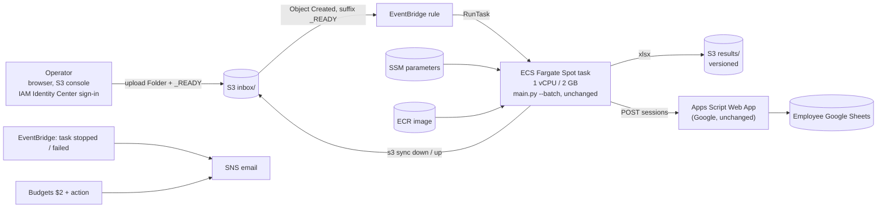
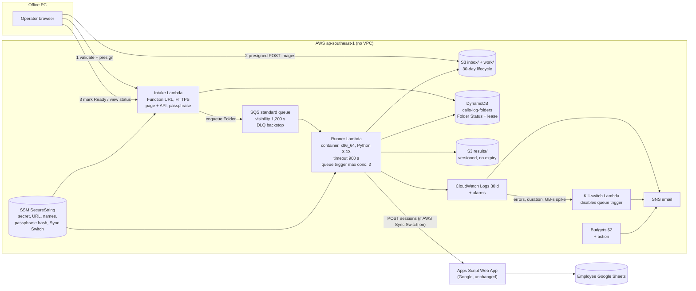
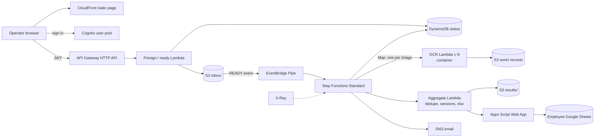

# calls-log on AWS: solution design

**Recommendation: Route B, Balanced.** It works like this:
- A small upload page sends each Folder to S3.
- A queue feeds one Lambda container that runs the **unchanged** pipeline on that Folder.
- Each Folder's state is kept in DynamoDB.
- Cost limits are set in the infrastructure, and everything is defined in Terraform.

The expected cost is **about $0.40 a month**, because OCR compute stays inside Lambda's
always-free allowance. If the Phase 0 measurement says otherwise, the same runner moves to
Fargate Spot (Route A's compute) without changing anything else. The binding rules are in
`ARCHITECTURE-SPINE.md` (AD-1 to AD-18).

---

## 1. Service-by-service mapping (current → AWS, Route B)

| Today (component, path) | On AWS | Notes |
|---|---|---|
| Operator files folders into `input_images/` | **Upload page** served by an intake Lambda (Function URL) → **S3** `inbox/<uploadId>/` through presigned POST | Validates the name, date and image count *before* upload (FR-2); "Mark ready" replaces the act of running the command (FR-3) |
| `main.py --batch` loop (`main.py:325-376`) | **SQS** standard queue → **Lambda** runner (container image), one message per Ready Folder | The runner calls the existing functions; there is no batch loop (AD-1, AD-2) |
| `image_preprocess.py`, `ocr.py`, `parser.py`, `session_builder.py`, `excel_writer.py` | Inside the runner image, **unchanged** | Same lockfile as the PC (AD-3) |
| `~/.paddlex` model cache (downloaded on first run) | Models **baked into the image**; `PADDLE_PDX_CACHE_HOME=/tmp/paddlex` at start-up; model-source check disabled | Risk ADV-07 |
| `secrets_local.py` (URL + secret) | **SSM Parameter Store** SecureString (`/calls-log/webapp_url`, `/calls-log/sync_secret`), read once per container | `config.py` gets an env path; the PC keeps `secrets_local.py` (AD-9) |
| `config.py` `sheets_sync_enabled` | SSM `/calls-log/sync_enabled`, read per Run (the AWS Sync Switch) | The PC switch stays in `config.py` (FR-29, AD-10) |
| `sheets_sync.py` → Apps Script Web App | Unchanged. The Lambda reaches Google through its default internet access (**no VPC**) | Web App code untouched (AD-12) |
| `apps_script/Employees.gs` names (Google side) | SSM `/calls-log/name_prefixes` (normalised prefixes only) for pre-OCR validation | Private; set out-of-band, never in the repo or Terraform state (AD-9) |
| Folder moved to `input_images/_processed/` = done (`main.py:196-217`) | **DynamoDB** `calls-log-folders` Folder Status record, written with conditional updates | Nothing is ever moved in S3 (AD-4) |
| `_prune_archive` (30 days, mtime) | **S3 lifecycle** on `inbox/`: expire 30 days after upload | Accepted deviation (FR-12) |
| `output/<Name> & <date>[(n)].xlsx` | **S3** `results/<Person-Day>.xlsx`, **versioning on**, never expires | Versions replace `(n)` copies (AD-8) |
| Folder kept on failure → retried next run | Attempt count in the status record. 3 failures → **Parked** + email. SQS dead-letter queue only as a crash backstop | FR-10, AD-6 |
| Reading the console log | **CloudWatch Logs** (30-day retention) + status shown on the upload page + **SNS** email alerts | FR-15, FR-16 |
| `resync_output.py` | Runner **`resync` mode** (invoked by the Owner) that reads `results/` | Uses `main.parse_name_date` (risk EC-07b) |
| `output/` history on the PC | One-off **import job** → `results/` + status backfill | Phase 7 "DB migration" = this (FR-14) |
| `.githooks` + `check_private_data.py` | **GitHub Actions** job that fails closed using a private denylist secret | FR-22 |
| `run_tests.py` | GitHub Actions test job + **Synthetic Set** OCR check in the built image | FR-24, FR-27 |
| (none) | **ECR** (image, keep the last 2), **Terraform** (state in S3 with `use_lockfile`), **IAM** OIDC role for GitHub, **Budgets** + **CloudWatch alarms** + kill switch | FR-17, FR-18, FR-21, FR-23 |
| DNS / TLS | **None needed.** The Function URL comes with an AWS-managed HTTPS endpoint; Google serves the Web App's TLS. A custom domain is deferred (Route 53 costs $0.50/month) | Phase 7 "DNS/TLS cutover" = moving the Operator to the page and rotating the secret |

---

## 2. Cost assumptions (shared by all routes)

| Input | Value | Source / status |
|---|---|---|
| Images per month | 8,700 (2,000/week); growth case 12,000 (18 employees) | owner 1a, 1c |
| Runs per month | ≈ 450 (most Folders < 20 images, max 40) | owner, PRD A5 |
| Time per image on AWS | **base 11 s**, **pessimistic 22 s** | laptop benchmark ×1 / ×2 [ASSUMPTION until Phase 0] |
| Peak memory | 740 MB | benchmark |
| Image size | 0.4 MB average → about 3.5 GB in `inbox/` at any time | [ASSUMPTION; measure from the Reference Set] |
| Container image in ECR | ≈ 1.2 GB compressed, keep 2 → 2.4 GB | [ASSUMPTION; measure at first build] |
| Lambda | $0.0000166667 per GB-s (x86); **400,000 GB-s + 1M requests free every month** | AWS; Singapore assumed equal to us-east-1 [ASSUMPTION] |
| Fargate Spot | 1.25 × us-east-1 Spot: $0.0155/vCPU-h, $0.0017/GB-h; public IPv4 $0.005/h | us-east-1 Spot from Vantage/Cloudchipr; Singapore uplift [ASSUMPTION] |
| S3 Standard | $0.025/GB-month; PUT $0.005 per 1,000 | [ASSUMPTION, Singapore] |
| ECR storage | $0.10/GB-month | AWS ECR pricing |
| Step Functions Standard | $0.025 per 1,000 transitions; 4,000 free | [ASSUMPTION, Singapore] |
| DynamoDB on-demand | ≈ $1.4 per million writes | [ASSUMPTION, Singapore] |
| Free or negligible | CloudWatch Logs (< 5 GB), 10 alarms, SNS email, SSM standard parameters, SSE-S3, 2 action-enabled budgets, S3 events to EventBridge | AWS free tier |

Every route has **no fixed monthly fee**: no NAT gateway, load balancer, always-on instance,
Secrets Manager, KMS customer key or Route 53 zone.

---

## 3. The three routes

### Route A: Minimal ("batch box on Fargate Spot")

The existing `main.py --batch` runs unchanged inside a Fargate Spot task, started when the
Operator uploads a `_READY` file. The Operator uploads through the S3 console after signing in
with IAM Identity Center. State is shown by S3 prefixes.

| | |
|---|---|
| Code change | Smallest: one wrapper script (S3 sync around `main.py`) plus the `config.py` env path |
| What it doesn't meet | **FR-2** (no pre-upload validation), **FR-3** (a manual `_READY` file is error-prone), **FR-15** (status needs the console), **FR-6** (no single-flight), a weak **FR-18** (no native concurrency cap on RunTask) |
| Cost | base **$1.15**, pessimistic **$1.78**, growth + pessimistic **$2.36** |

### Route B: Balanced (serverless queue), **recommended**

An upload page validates and uploads each Folder and marks it Ready. Each Ready Folder becomes one
SQS message. A Lambda runner, built from a container image that also runs on Fargate, processes
one Folder per invocation with per-image checkpoints. DynamoDB owns each Folder's state, and
infrastructure-level guardrails cap concurrency and spend.

| | |
|---|---|
| Code change | New `cloud/` adapters: runner, intake, status, storage, settings (≈ 500–700 LOC), plus the `config.py` env path. The pipeline is untouched |
| PRD coverage | All FRs. 15-min cap → per-image checkpoints (AD-16). FR-6 → lease (AD-5). FR-18 → queue-trigger concurrency 2 + kill switch that disables the trigger (AD-11), with reserved concurrency added once the account quota allows |
| Cost | base **$0.39**, pessimistic **$0.39** (387k GB-s, still free), growth + pessimistic **$2.60 at 2 GB** / **≈ $0.40 at 1.5 GB** (≈ 399k GB-s, only just inside the free tier). Memory size is the main lever; Phase 0 picks the size with the lowest GB-s per image |

### Route C: Cloud-native (orchestrated fan-out)

Cognito sign-in to a CloudFront-hosted page, an API Gateway HTTP API, and Step Functions that fan
out **one Lambda per image**, then aggregate and Sync. Adds EventBridge Pipes and X-Ray tracing.

| | |
|---|---|
| Code change | Largest: the pipeline is split into per-image and aggregate steps. Aggregation must reproduce `extract_calls` ordering exactly, or `dedupe`'s "keep first" changes results |
| PRD coverage | All FRs, but with **parity risk** (fan-out) and **cost risk** (a cold start per image) |
| Cost | base **$1.01** (Step Functions $0.61 + ECR + S3), pessimistic **$2.20**, growth + pessimistic **> $3** |

---

## 4. Cost per route (monthly, Singapore)

| Line item | A: Minimal | B: Balanced | C: Cloud-native |
|---|---|---|---|
| OCR compute, base | Fargate Spot 32 task-h → $0.61 | Lambda 195k GB-s → **$0** (free) | Lambda 278k GB-s → $0 |
| OCR compute, pessimistic | 59 task-h → $1.11 | 387k GB-s → **$0** (97% of free) | 470k GB-s → $1.17 |
| Public IPv4 while running | $0.16–0.29 | — | — |
| Orchestration | EventBridge $0 | SQS $0, DynamoDB ≈ $0.01 | Step Functions ≈ $0.61, API GW ≈ $0.01 |
| ECR (2 × 1.2 GB) | $0.24 | $0.24 | $0.24 |
| S3 storage + requests | $0.14 | $0.14 | $0.14 |
| Logs, alarms, SNS, SSM, Budgets | $0 | $0 | $0 (X-Ray within free) |
| **Total, base** | **$1.15** | **$0.39** | **$1.01** |
| **Total, pessimistic (2× slower)** | **$1.78** | **$0.39** | **$2.20** |
| **Total, growth + pessimistic** | **$2.36** ✗ | **$2.60** ✗ at 2 GB → **$0.40** at 1.5 GB | **> $3** ✗ |

Worst-case runaway (FR-18). Route B's runner is capped at 2 concurrent runs by its queue trigger,
so it burns at most 2 × 2 GB × 3,600 s = 14,400 GB-s/hour, which is $0.24/hour once past the free
tier. The kill switch disables the trigger after a 15-min alarm, so the exposure is **about
$0.06**, within the $0.50 limit. Route A has no native cap. Route C's exposure scales with the
Map concurrency.

---

## 5. Trade-offs

| Criterion | A: Minimal | B: Balanced | C: Cloud-native |
|---|---|---|---|
| Expected cost / headroom to $2 | $1.15 / thin | **$0.39 / wide** | $1.01 / thin |
| PRD coverage | Misses FR-2, FR-3, FR-6, FR-15, and FR-18 is weak | **All** | All |
| Parity risk | **Lowest** (runs `main.py` as-is) | Low (calls the same functions, sorted order) | Medium (per-image split, ordering) |
| Turnaround (20-image Folder) | ~5 min (task start 45–60 s) | **~4 min** | ~1–2 min (fan-out) |
| 15-min limit risk | None | Mitigated (checkpoints) | None |
| Cost guardrails | Weak (no concurrency cap on RunTask) | **Strong** (queue-trigger cap + kill switch; reserved concurrency once the quota allows) | Medium |
| Operator experience | S3 console + manual `_READY` | **One page: validate, upload, ready, status** | One page + Cognito sign-in |
| Security | Identity Center users get console access to the bucket | Passphrase page + presigned POST (no AWS keys) | **Cognito** (strongest identity) |
| Moving parts (Terraform resources, approx.) | **~20** | ~35 | ~60 |
| Build size | **S** | M | L |
| Portfolio value (Cloud/DevOps) | Low–medium | **High** (event-driven, IaC, OIDC, guardrails, FinOps) | Highest, but runs against SM-C3 |
| Fallback path | — | **Runner moves to Fargate Spot** (Route A compute) | Hard to fall back |

---

## 6. Recommendation and decision

**Route B, Balanced (serverless queue)**, with Route A's Fargate Spot as the documented fallback
for the runner only.

- It is the only route that covers every PRD requirement with headroom under $2. Its compute sits
  inside a permanent free allowance, and memory size is a tunable lever.
- Parity risk stays low: the runner calls the existing functions in the existing order (AD-1,
  AD-2), with no fan-out.
- Its guardrails are native and testable, which FR-18 needs.
- It is the strongest *honest* portfolio piece: event-driven serverless, Terraform, OIDC CI/CD,
  least-privilege IAM, and measured FinOps, with nothing added for show (SM-C3).
- Route A is kept as the escape hatch, not discarded. If Phase 0 measures more than about 22 s
  per image at the GB-s-optimal memory, the runner image's CLI entrypoint runs on Fargate Spot
  (AD-15).
- Route C is rejected for now. Fan-out adds parity and cost risk to buy turnaround the Owner
  doesn't need: B already lands in minutes against a 2-hour target.

Logged as decision **D-8** in `_bmad-output/project-context.md` and in `.memlog.md`. The Owner can
override it before Step 5.

## 7. Phase 0 exit criteria (before building B)

1. The lockfile is generated from the production PC's `pip freeze` (OQ-1). The image builds on
   x86_64 Python 3.13.
2. Run the Reference Set locally, in the runner image (Docker or WSL2 on the PC), and get 100%
   Parity (FR-26).
3. Measure GB-s per image at 1,536 / 2,048 / 3,008 MB in Lambda on the Synthetic Set, and pick the
   minimum. The projected monthly GB-s at 12,000 images must be ≤ 350,000.
4. A 40-image Folder finishes inside one invocation, or resumes cleanly from checkpoints.
5. The image builds with `mesa-libGL` + `glib2` from `dnf` on the AL2023 base, and a smoke test
   runs `diagnose.py` on a synthetic image inside it.
6. The account's Lambda concurrency quota has been raised (Service Quotas), so reserved
   concurrency can be applied. Until then the queue-trigger cap and the kill switch carry FR-18.
7. A Function URL deployed with both permission statements (AD-17) answers `GET /` with 200.

## Sources

- AWS Lambda runtimes: https://docs.aws.amazon.com/lambda/latest/dg/lambda-runtimes.html
- SQS event source mapping configuration: https://docs.aws.amazon.com/lambda/latest/dg/services-sqs-configure.html
- Terraform S3 native locking: https://dev.to/drewmullen/terraform-state-with-native-s3-locking-1fck
- hashicorp/aws v6.56.0: https://newreleases.io/project/github/hashicorp/terraform-provider-aws/release/v6.56.0
- configure-aws-credentials v6: https://context7.com/aws-actions/configure-aws-credentials
- GitHub OIDC in AWS: https://docs.github.com/en/actions/how-tos/secure-your-work/security-harden-deployments/oidc-in-aws
- Fargate pricing (us-east-1 Spot reference): https://www.vantage.sh/blog/fargate-pricing, https://cloudchipr.com/blog/aws-fargate-pricing
- Lambda free tier (2026): https://spot.rackspace.com/blog/aws-free-tier
- ECR pricing: https://aws.amazon.com/ecr/pricing
- paddlepaddle 3.3.1 wheels: https://pypi.org/project/paddlepaddle/3.3.1/#files
- Lambda reserved concurrency (100 unreserved minimum): https://docs.aws.amazon.com/lambda/latest/dg/configuration-concurrency.html
- Function URL permissions (Oct 2025 change): https://docs.aws.amazon.com/lambda/latest/dg/urls-auth.html
- Lambda Python base image (AL2023, dnf): https://docs.aws.amazon.com/lambda/latest/dg/python-image.html
