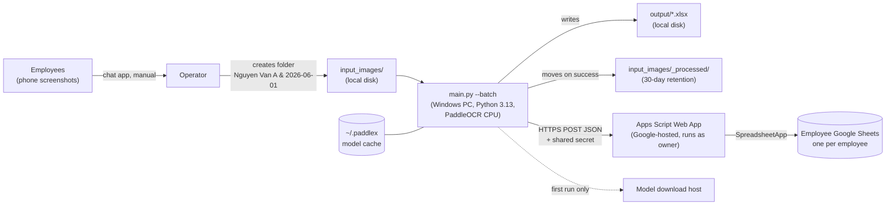
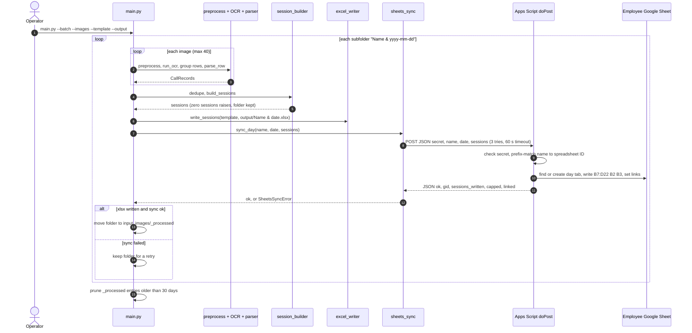

# calls-log: brownfield system documentation

This is an inventory of the system as it exists, the input to the AWS migration (Steps 2–5).
Every claim cites `path:line`. The first draft came from reading the code only: the snapshot had
no virtualenv or Python install. **Update 2026-10-14:** Python 3.13.15 and `.venv` were installed
(paddlepaddle 3.3.1, paddleocr 3.7.0, paddlex 3.7.2, opencv 4.10.0.84, numpy 2.3.5, Pillow 12.3.0,
openpyxl 3.1.5), and `run_tests.py` passed 81 of 81. No OCR run has been done, and the snapshot
still has no `secrets_local.py`, no `apps_script/Employees.gs`, and empty `input_images/` and
`output/`.

---

## 1. The system at a glance

**What it is:** an operator-run, single-machine **Windows command-line batch job**. It OCRs
phone call-log screenshots, turns them into daily call sessions, writes one Excel file per
person per day, and pushes the same day into that employee's Google Sheet
(`README.md:1-8`, `main.py:1-20`).

**What it is not:** a web service. The Python side has no HTTP listener, database, daemon,
scheduler or queue. The only network endpoint is a **Google Apps Script Web App** that Google
hosts and that runs as the owner's Google account (`apps_script/WebAppSync.gs:1-22`,
`docs/TECHNICAL.md:256-261`).

### Components

| Component | Where it lives | Owned by | Cite |
|---|---|---|---|
| Python pipeline (8 modules + tools) | repo root | this repo | `docs/TECHNICAL.md:11-31` |
| Day-sheet template `sprs.xlsx` | repo root (the only tracked workbook) | this repo | `.gitignore:61-63` |
| Apps Script Web App | **live Google project** (source of truth); reference copy in `apps_script/WebAppSync.gs` | Google account of the owner | `AGENTS.md` → Where things are; `docs/TECHNICAL.md:310-312` |
| Employee map `NAME_TO_ID` | `apps_script/Employees.gs` (gitignored) + the live project | owner | `apps_script/Employees.example.gs:16-19` |
| Credentials | `secrets_local.py` (gitignored) | operator PC | `config.py:23-28` |
| Employee Google Sheets | Google Drive, one per employee | owner | `docs/TECHNICAL.md:276-289` |

### Observed workload (for sizing later; derived, not measured)

> **Superseded by the owner's figures (2026-10-14):** 13 employees (about 18 in 12 months) and
> about 2,000 images per batch, one or two batches a week. See `_bmad-output/project-context.md`.
> The figures below are what the repo itself shows.

- About **8 employee spreadsheets** (`apps_script/WebAppSync.gs:394`, "all 8 sheets").
- **38 person-days over 27–31 July 2026**, roughly 7–8 folders per working day
  (`docs/TECHNICAL.md:421-422`).
- **≤ 40 images per folder**, with a warning above 35 (`config.py:34-35`).
- **About 5 s per image on 10 cores**, plus 10–20 s of engine start-up per run
  (`docs/TECHNICAL.md:246-250`, `docs/TECHNICAL.md:371`).
- Derived: worst case ≈ 8 folders × 40 images × 5 s ≈ **27 min of CPU per day**. A typical day
  is a fraction of that. Run as one process per batch, the load is bursty and small.

---

## 2. Entry points

| # | Entry point | Kind | Trigger | Side effects | Cite |
|---|---|---|---|---|---|
| E1 | `main.py` → `_run()` → `main()`, **batch mode** (`--batch`) | CLI | Operator, manually | Reads `input_images/*/`. Writes `output/*.xlsx`. **POSTs to the Web App.** **Moves** each finished folder to `_processed/`. Prunes the archive | `main.py:325-376`, `main.py:379-444`, `main.py:486-506` |
| E2 | `main.py`, **single-folder mode** | CLI | Operator / debugging | Writes the xlsx, `review_report.csv` and `processing_log.json`. **No sync and no archiving** | `main.py:446-483` |
| E3 | `resync_output.py` | CLI | Operator (backfill/repair) | Reads `output/*.xlsx` back and POSTs every day. **Forces sync on** and overwrites live tabs | `resync_output.py:114-169`, `resync_output.py:129-131` |
| E4 | `diagnose.py <image>` | CLI | Developer | Prints the OCR and parse trace for one image. No writes, no sync | `diagnose.py:37-108` |
| E5 | `create_template.py <path>` | CLI | One-off | Writes a blank template workbook | `create_template.py` (`create_template()`, `__main__`) |
| E6 | `run_tests.py` → `tests.py` | Test runner | Developer | None. Network calls are mocked | `run_tests.py:63-65`, `tests.py:421-428` |
| E7 | `tools/check_private_data.py` | git hook | `pre-commit` / `pre-push`, opt-in via `core.hooksPath` | None; exit 1 blocks the commit or push | `.githooks/pre-commit`, `.githooks/pre-push`, `.githooks/_run_check.sh`, `docs/TECHNICAL.md:455-460` |
| E8 | Apps Script `doPost(e)` | **Public HTTPS endpoint** ("Anyone" access) | E1 / E3 | Creates or overwrites day tabs and writes links in the employee's spreadsheet | `apps_script/WebAppSync.gs:102-240`, `apps_script/README_SETUP.md:26-34` |
| E9 | Apps Script `doGet()` | Public HTTPS health check | Browser | None | `apps_script/WebAppSync.gs:242-244` |
| E10 | Apps Script maintenance functions: `backfillMonthLinks[DryRun]`, `backfillOverviewLinks[DryRun]`, `repairTimes`, `sortDayTabsAll`, `purgePreAugust[DryRun]` | Run by hand in the Apps Script editor | Owner | Bulk edits, tab reordering, **tab deletion** (purge) across employee sheets | `apps_script/WebAppSync.gs:298-299`, `:342-343`, `:399`, `:499`, `:586-587` |

The repo contains no scheduler: no Task Scheduler export, cron, service unit or CI trigger (§8).
Runs start by hand with the "canonical daily command" (`README.md:106-115`,
`docs/TECHNICAL.md:96-100`).

---

## 3. Request flow trace (batch mode, the production path)

### 3.1 Step by step

1. **Process start.** `import runtime_env` runs first and sets the OpenMP and thread variables
   before any native library loads (`main.py:24`, `runtime_env.py:34-70`). Logging is configured
   at INFO (`main.py:45-49`).
2. **Argument parsing.** `--images`, `--template` and `--output` are required (`main.py:383-391`).
   Flags change the global `CONFIG` in place: `--ocr-engine`, `--allow-engine-fallback`,
   `--delete-input` (`main.py:426-431`). `--keep-input` turns archiving off (`main.py:443`).
3. **Folder discovery.** Every subfolder of `--images` is processed in sorted order, skipping
   `_processed`, `_archive` and dot-folders (`main.py:335-341`). Loose files are ignored
   (`main.py:17-18`).
4. **Per folder** (`_process_one_folder`, `main.py:241-322`):
   1. **Gather images:** `.jpg .jpeg .png .webp .bmp`, at most 40 (`main.py:54-77`).
   2. **Per image** (`extract_calls`, `main.py:80-155`). One bad image does not stop the folder
      (`main.py:98-118`):
      - **Preprocess** (`image_preprocess.preprocess`, `image_preprocess.py:428-471`): EXIF
        transpose → screenshot-or-photo test → rotation check → for photos, perspective
        rectification, deskew and denoise/CLAHE → upscale to 1600 px.
      - **OCR** (`ocr.run_ocr`, `ocr.py:380-444`): PaddleOCR 3.x is built once and cached
        (`ocr.py:109-153`, `ocr.py:239-264`). It refuses to load a second deep-learning framework
        (`ocr.py:66-86`). Any engine failure is fatal while `ocr_strict_engine` is on
        (`ocr.py:436-440`).
      - **Row grouping** into y-bands (`ocr.group_lines_into_rows`, `ocr.py:465-515`).
      - **Parse each row** into a `CallRecord`: start time, duration, direction, status,
        whether it counts (`parser.parse_row`, `parser.py:470`; `parser.is_countable`,
        `parser.py:401`).
   3. **Deduplicate** (`session_builder.dedupe`, `session_builder.py:78-132`) and **build
      sessions** with the gap rules (`session_builder.build_sessions`,
      `session_builder.py:139-235`). The rules are in `docs/TECHNICAL.md:190-207`.
   4. **Guard:** zero sessions raises `RuntimeError`. Nothing is written and the folder stays
      (`main.py:269-280`).
   5. **Write the xlsx:** copy `sprs.xlsx`, fill B7:D22, set B2 `=SUM`, set B3 to the first
      start, and insert rows past 16 sessions (`excel_writer.write_sessions`,
      `excel_writer.py:37-122`). If the filename is taken, a `(n)` suffix is added
      (`main.py:180-193`).
   6. **Sync**, if `CONFIG.sheets_sync_enabled` (default `True`, `config.py:184`): split
      `<Name> & yyyy-mm-dd` into name and date (`main.py:161-177`), then `sheets_sync.sync_day`
      (`sheets_sync.py:32-106`).
   7. **Retire the folder**, only if the xlsx was written **and** sync succeeded: move it to
      `input_images/_processed/` (`main.py:196-217`, `main.py:307-320`).
5. **After all folders:** delete archived folders older than 30 days (`main.py:220-238`,
   `config.py:177`). Exit code is 0 when everything succeeded, 1 when any folder failed
   (`main.py:368-376`), and 130 on `KeyboardInterrupt` (`main.py:486-502`).

### 3.2 Sequence

### 3.3 Wire contract: Python → Web App

| Item | Value | Cite |
|---|---|---|
| Method / URL | `POST <SHEETS_WEBAPP_URL>` (the deployment's `/exec`) | `sheets_sync.py:51-56` |
| Request body | `{"secret", "name", "date": "yyyy-mm-dd", "sessions": [{"start": "HH:MM", "end": "HH:MM"}]}` | `sheets_sync.py:44-49` |
| Authentication | Shared secret in the body, compared to the script's `SECRET` literal | `apps_script/WebAppSync.gs:36`, `:105` |
| Success response | `{ok: true, name, date, gid, sessions_written, capped, linked, month_linked, month_tab, overview_linked}` | `apps_script/WebAppSync.gs:231-236` |
| Errors | Returned **in the body** with `ok: false`: `bad secret`, `unknown name: …`, `no template tab`, or the exception text | `apps_script/WebAppSync.gs:105`, `:108`, `:126`, `:237-239` |
| Client handling | Retries `URLError`/`OSError` with 1 s then 2 s backoff; non-JSON or `ok: false` raises `SheetsSyncError` | `sheets_sync.py:58-93`, `config.py:190-193` |
| Idempotency | Same person and date: overwrites B7:D22, B2, B3 in the existing tab and never creates a duplicate (matched with `dayKey_`) | `apps_script/WebAppSync.gs:128-135`, `:175`; `apps_script/README_SETUP.md:65-66` |
| Capacity | The Sheets side caps at 16 sessions and the xlsx side expands, so they can disagree on busy days | `apps_script/WebAppSync.gs:172-173`, `docs/TECHNICAL.md:432-434` |

**Redirect (outside the repo, verify before writing egress rules):** Apps Script `/exec`
endpoints answer by redirecting to a `script.googleusercontent.com` URL. Python's `urllib`
follows that redirect (`sheets_sync.py:68`), so outbound HTTPS has to reach both Google hosts.

### 3.4 How the other entry points differ

- **Single-folder mode** (`main.py:446-483`) runs the same pipeline but stops after
  `write_sessions`. It also writes `review_report.csv` and `processing_log.json`
  (`review_report.py:38`, `review_report.py:95`). It does **not** sync and does **not** archive. It aborts if every
  image failed OCR (`main.py:455-459`).
- **`resync_output.py`** skips OCR. It reads B/C cell values back from each
  `<Name> & yyyy-mm-dd[(n)].xlsx`, preferring the copy without a suffix
  (`resync_output.py:73-111`), and POSTs through the same `sync_day`. The xlsx files are the
  **source of truth** for a resync (`resync_output.py:8-9`).

---

## 4. Data layer

**There is no database.** State lives in local folders, Excel files, a Python module holding
credentials, and Google Sheets that are reachable only through the Web App.

| Store | Location | Format | Written by | Read by | Lifecycle | Sensitivity | Cite |
|---|---|---|---|---|---|---|---|
| Inbox | `input_images/<Name> & yyyy-mm-dd/` | jpg, jpeg, png, webp, bmp | Operator | `main.py` | Moved on success; kept on failure | **PII**: customer phone numbers, employees' call history | `main.py:54`, `docs/TECHNICAL.md:442` |
| Archive | `input_images/_processed/<folder>[ (timestamp)]` | same | `main.py` | nobody (recovery only) | Deleted when its **mtime** is over 30 days old; 0 means keep forever | PII | `main.py:196-238`, `config.py:173-177` |
| Output | `output/<Name> & <date>[(n)].xlsx` | xlsx from the template | `excel_writer` | Operator, `resync_output.py` | **Never pruned**; numbered copies on reruns | Employee working hours | `main.py:180-193`, `excel_writer.py:37-122` |
| Review artifacts (single mode only) | next to the output: `review_report.csv`, `processing_log.json` | CSV / JSON | `review_report.py` | Operator | Never pruned | Raw OCR row text (`raw_text`), which may contain whatever the row showed | `main.py:447-448`, `review_report.py:55`, `review_report.py:105-111` |
| Template | `sprs.xlsx`, sheet `Trang tính1`, rows 7–22 | xlsx | `create_template.py` (one-off) | `excel_writer` | Tracked in the repo | none | `config.py:154-162`, `.gitignore:63` |
| Model cache | `~/.paddlex` (PaddleX default) | model weights | PaddleOCR on first run | PaddleOCR | Persistent; downloaded once (~200 MB) | none | `.gitignore:84-89`, `README.md:245-246`, `docs/TECHNICAL.md:37-39` |
| Credentials | `secrets_local.py` | Python module | Operator | `config.py` | Manual | **Secret**: URL + secret give write access to every sheet | `config.py:15-28`, `secrets_local.example.py:9-19` |
| Employee sheets | Google Drive, one spreadsheet per employee; tabs `🏠 Tổng quan`, month tabs, day tabs, `📄 Mẫu` | Google Sheets | Apps Script, as the owner | Employees / managers | Day tab overwritten on every sync of that date | Working hours | `docs/TECHNICAL.md:276-289` |
| Web App state | Live Apps Script project: `SECRET` literal, `Employees.gs` map, one-off seed loader not in the repo | Apps Script | Owner, in the editor | `doPost` | Changes take effect only on "new version" redeploy | **Secret** and the name ↔ ID map | `apps_script/WebAppSync.gs:24-42`, `docs/TECHNICAL.md:310-312` |

**Keys and identity.** The **folder name is the primary key.** The part before the date picks
the spreadsheet: it is lower-cased, accent-stripped, `đ`→`d`, then prefix-matched with the first
match winning (`apps_script/WebAppSync.gs:50-64`). The `yyyy-mm-dd` part picks the tab
(`main.py:158-177`, `apps_script/WebAppSync.gs:110-121`). Renaming a folder changes whose sheet
it writes to (`docs/TECHNICAL.md:293-299`).

**Business rules** (how a call counts, rounding, the 5-minute gap, the post-09:00 exception
limited to 4 per day) are fully covered in `docs/TECHNICAL.md:190-207` and pinned by
`tests.py:80-245`. The migration must not change them.

---

## 5. Configuration and environment variables

### 5.1 How configuration works

- All behaviour comes from **one mutable dataclass singleton**, `CONFIG = Config()`, with
  hard-coded defaults (`config.py:31-196`).
- Three places change it at runtime: CLI flags (`main.py:426-431`), the oneDNN self-heal
  (`ocr.py:262`), and `resync_output.py`, which forces sync on (`resync_output.py:131`).
- **The application reads no environment variables and no config file.** Changing a setting means
  editing `config.py`.
- Credentials arrive as a **Python import** from `secrets_local.py` (`config.py:23-28`). If the
  file is missing, both values are empty and every sync fails loudly (`sheets_sync.py:41-42`).

### 5.2 Secrets

| Secret | Where it lives | Consumed at | Must match | Cite |
|---|---|---|---|---|
| `SHEETS_WEBAPP_URL` | `secrets_local.py` | `config.sheets_webapp_url` → `sheets_sync.py:51-52` | the live deployment's `/exec` URL | `config.py:186`, `secrets_local.example.py:9-11` |
| `SHEETS_SYNC_SECRET` | `secrets_local.py` | `config.sheets_sync_secret` → request body | `var SECRET` in the live script | `config.py:188`, `secrets_local.example.py:13-15` |
| `SECRET` (Apps Script) | literal in the live script; redacted in the repo | `doPost` | `SHEETS_SYNC_SECRET` | `apps_script/WebAppSync.gs:24-36` |
| `NAME_TO_ID` + ID lists | `Employees.gs` (live project + gitignored local copy) | `matchId_`, maintenance functions | none | `apps_script/Employees.example.gs:16-27` |

### 5.3 Every environment variable

| Variable | Set or read by | Value | Effect | Can a runtime override it? | Cite |
|---|---|---|---|---|---|
| `KMP_DUPLICATE_LIB_OK` | **set** by `runtime_env.configure()` (`setdefault`) | `TRUE` | Tolerate a duplicate Intel OpenMP runtime instead of aborting | Yes; `setdefault` keeps an existing value | `runtime_env.py:43`, `:57-58` |
| `KMP_INIT_AT_FORK` | set (`setdefault`) | `FALSE` | OpenMP fork-init handling | Yes | `runtime_env.py:45` |
| `KMP_BLOCKTIME` | set (`setdefault`) | `0` | OpenMP threads sleep immediately instead of spin-waiting | Yes | `runtime_env.py:46` |
| `OMP_NUM_THREADS` | set (`setdefault`) | `os.cpu_count()` | OpenMP thread count | Yes | `runtime_env.py:51` |
| `MKL_NUM_THREADS` | set (`setdefault`) | `os.cpu_count()` | MKL thread count | Yes | `runtime_env.py:52` |
| `PADDLE_PDX_DISABLE_DEV_MODE` | set (`setdefault`) | `1` | Quiets the PaddleX banner and dev mode | Yes | `runtime_env.py:54` |
| `FLAGS_call_stack_level` | set (`setdefault`) | `1` | Paddle error stack verbosity | Yes | `runtime_env.py:55` |
| `HTTP_PROXY` / `HTTPS_PROXY` (`NO_PROXY`) | **read implicitly** by `urllib` (sync) and the model downloader | unset | Proxy for the Web App call and the first-run model download | n/a | `docs/TECHNICAL.md:368-369`, `sheets_sync.py:68` |
| `HOME` / `USERPROFILE` | read implicitly by PaddleX | OS default | Where the `~/.paddlex` model cache goes | n/a | `.gitignore:84-87` |
| `PYTHONUTF8` (or `-X utf8`) | Python interpreter | unset | Needed when test output is piped, or Japanese names raise `UnicodeEncodeError` | n/a | `AGENTS.md` → Running and verifying, `docs/TECHNICAL.md:72-77` |

PaddleX has its own environment variables (cache location, model source). The repo sets none of
them. Check their exact names against whichever PaddleX version gets pinned before relying on
them.

---

## 6. Statefulness

| Kind | State | Consequence for a cloud runtime | Cite |
|---|---|---|---|
| In-process cache | The PaddleOCR instance is built once per process, which costs 10–20 s | Prefer one process per batch over one process per image | `ocr.py:93`, `ocr.py:243-244`, `docs/TECHNICAL.md:371` |
| In-process lock | `_engine_in_use` and `_loaded_framework` pin one engine and one framework per process | Must hold in any image; never ship torch next to paddle | `ocr.py:62-86`, `ocr.py:377`, `ocr.py:430-432` |
| Global mutable config | `CONFIG` is changed by flags and by the self-heal | One process = one configuration | `main.py:426-431`, `ocr.py:262` |
| **Filesystem as queue** | A folder in `input_images/` means pending; moved to `_processed/` means done | "Done" is a **rename**. An object store has no atomic rename, so this needs a replacement with the same semantics | `main.py:307-320`, `main.py:196-217` |
| Retry semantics | A failed folder stays put and is reprocessed on the next run. A rerun after the xlsx was written produces `Name & date(1).xlsx` | Output names depend on what already exists in `output/` | `main.py:180-193`, `docs/TECHNICAL.md:113-114` |
| **No concurrency control** | No lock file, so two concurrent runs would process the same folders | A scheduler must not start overlapping runs | `main.py:325-376` (no lock anywhere) |
| Apps Script has no lock | Tab creation is look-up-then-insert with no `LockService` | Hidden today because sync is sequential (`main.py:352`). **If folders run in parallel, two folders for the same person and date could race** | `apps_script/WebAppSync.gs:131-169` |
| Retention clock | Pruning uses the archived folder's mtime, and a rename does not refresh it | Retention runs from the last change to the folder's contents, not from the archive time | `main.py:228-234` |
| Model cache | Downloaded on the first run, then reused offline | Bake it into the image or mount it; otherwise every cold start downloads about 200 MB | `README.md:245-246` |
| Ordering | Sessions exist only inside one person-day, and folders are independent | Work can split per folder (subject to the Sheets race above) | `session_builder.py:139-235`, `main.py:352-366` |

---

## 7. Native and OS dependencies

| Dependency | Constraint | Native part | Notes | Cite |
|---|---|---|---|---|
| OS | Windows 11 in production | — | Windows-only branch: console stdout/stderr switched to UTF-8. The oneDNN bug and the `libiomp5md.dll` clash are documented as Windows issues. Paths are otherwise portable (`pathlib`, `shutil`) | `runtime_env.py:7-17`, `runtime_env.py:60-67`, `config.py:86-93` |
| Python | 3.13 in the venv; docs say 3.10+ | CPython | venv path `.venv\Scripts\python.exe`; `.venv-1` has no packages | `docs/TECHNICAL.md:37`, `AGENTS.md` → Running and verifying |
| `paddlepaddle` | `>=3.0` (CPU) | Intel OpenMP / MKL; oneDNN **turned off** | `paddle_enable_mkldnn = False` is mandatory on Windows. Keep it for parity elsewhere | `requirements.txt:16`, `config.py:86-93` |
| `paddleocr` | `>=3.0` (brings in PaddleX) | model weights | PP-OCRv5 mobile recogniser, pipeline-default detector, document-orientation classifier | `requirements.txt:15`, `config.py:54-85`, `ocr.py:122-147` |
| `opencv-python` | `>=4.5` | **GUI build**, which on Linux needs system GL/glib libraries | Used only for image math; the headless wheel is a packaging alternative to verify. **Conflict:** as written this now resolves to OpenCV 5.0, while `paddlex[ocr-core]` (pulled in by `paddleocr` 3.7) pins `opencv-contrib-python==4.10.0.84`. Both install the same `cv2` module, so the last one installed wins. The 2026-10-14 install pinned `opencv-python==4.10.0.84` through a constraints file | `requirements.txt:18-21`, `image_preprocess.py:46-52` |
| Microsoft Visual C++ 2015–2022 x64 Redistributable | any current version (14.51 installed 2026-10-14) | `msvcp140.dll`, `vcruntime140*.dll` | **Undocumented prerequisite.** Without it `import paddle` fails with `DLL load failed while importing libpaddle`. Neither `README.md` nor `docs/TECHNICAL.md` mentions it | observed on install, 2026-10-14 |
| `numpy`, `Pillow`, `openpyxl` | `>=1.24,<3`, `>=10.0`, `>=3.1` | numpy BLAS; Pillow codecs (JPEG, PNG, WebP, BMP) | No HEIC support | `requirements.txt:2-4`, `docs/TECHNICAL.md:138-140` |
| `easyocr` / `torch` | **must not be installed** next to paddle | second OpenMP runtime | Causes phantom `KeyboardInterrupt` | `requirements.txt:6-14`, `ocr.py:54-86` |
| `pytesseract` + `tesseract` binary | optional; not installed | separate process | Only adds OSD rotation detection | `requirements.txt:25-29`, `image_preprocess.py:237-269` |
| Pinning | **lower bounds only, no lockfile** | — | Builds are not reproducible | `requirements.txt` |
| CPU | `paddle_cpu_threads = 10` (fixed); OMP/MKL = `os.cpu_count()` | — | In containers `os.cpu_count()` can report host cores rather than the CPU quota | `config.py:94-95`, `runtime_env.py:51-52` |
| Memory | **not documented or measured anywhere** | — | Must be measured before sizing | — |
| GPU | not used | — | CPU build | `requirements.txt:16`, `docs/TECHNICAL.md:39` |
| Disk | about 1.5 GB for install + models | — | | `docs/TECHNICAL.md:37-39` |
| Text encoding | Folder names carry Vietnamese diacritics, `&` and spaces, and act as keys | — | Matching normalises with NFD (`norm_`), so NFC vs NFD bytes in storage keys need care | `main.py:161-177`, `apps_script/WebAppSync.gs:50-57` |
| Time zone | **Not used by the logic.** Times are wall-clock `HH:MM` read from the screenshots; the date comes from the folder name | — | Only log timestamps and the archive-collision suffix use local time | `parser.py:26`, `session_builder.py:33`, `main.py:215` |
| Tooling | `git` + POSIX `sh` for hooks | — | Hooks prefer `.venv/Scripts/python.exe`, then `.venv/bin/python` | `.githooks/_run_check.sh` |
| Network egress | PyPI (install), model host (first run), `script.google.com` + `script.googleusercontent.com` (sync) | — | Nothing else is called | `README.md:245-246`, `sheets_sync.py:51-68` |

---

## 8. Existing Docker, IaC and CI

**None exist.** I searched the whole tree for Dockerfiles, compose files, Terraform/CDK/
CloudFormation/SAM/Serverless templates, Procfiles, systemd units, GitHub Actions, GitLab CI,
Azure Pipelines, Makefiles, `pyproject.toml`/`setup.*`/`tox.ini`, lockfiles, shell or PowerShell
deploy scripts, and `.clasp.json`/`appsscript.json`. The only hit was `.githooks/_run_check.sh`.

What does exist:

| Mechanism | What it does | Cite |
|---|---|---|
| Local git hooks (opt-in per clone) | Run `check_private_data.py` on commit (`--staged`) and on push | `.githooks/*`, `docs/TECHNICAL.md:455-460` |
| `.gitattributes` | Forces LF endings in hook scripts | `.gitattributes` |
| Manual "deploy" of the Python side | Copy the folder, create the venv, `pip install -r requirements.txt`, fill `secrets_local.py`, run the tests | `README.md:228-246` |
| Manual deploy of the Google side | Edit in the Apps Script editor, then Manage deployments → New version. **No clasp, no version control link** | `apps_script/README_SETUP.md:81-89` |
| Tests | `run_tests.py` covers the parser, session builder and sync client. `image_preprocess`, `ocr`, `excel_writer` and `main` orchestration have **no tests** | `tests.py:12-19`, `tests.py:421-428` |

This snapshot has **no `.git` directory**, so the remote, branches and history (and therefore
where GitHub OIDC → ECR would attach) can't be determined from here.

---

## 9. Parts of the system outside this repo

- The **live Apps Script project** and its deployment: the `/exec` URL, its version history, the
  real `SECRET`, the real `Employees.gs`, and a seed loader that isn't in the repo
  (`docs/TECHNICAL.md:310-312`).
- **`secrets_local.py`** and **`apps_script/Employees.gs`** on the operator PC (both missing here).
- **`../DRIVE_STRUCTURE.md`** and **`../HANDOFF.md`**, referenced in `AGENTS.md` → Where things
  are. They are **not present** next to this download.
- The **operator PC**: its venv, model cache, inbox, archive and output folders, and any
  Task Scheduler entries (unknown).
- **How screenshots arrive**: employees send them through a chat app and the operator files them
  by hand (`README.md:23-25`, `docs/TECHNICAL.md:140`).

---

## 10. Notes passed to Step 2 (risk assessment)

These are pointers only, not findings yet:

1. The Web App is open to "Anyone" and protected by one shared secret held as a literal in the
   script (`apps_script/README_SETUP.md:26-34`, `apps_script/WebAppSync.gs:33-36`).
2. Configuration lives in code, credentials come from a Python import, and nothing reads the
   environment (§5).
3. The filesystem rename acts as the commit point of a queue (§6).
4. Dependencies are unpinned and there is no lockfile. That has already caused an OpenCV 5.0 vs
   4.10 `cv2` clash, and the VC++ runtime prerequisite is undocumented (§7).
5. The parallelism hazard in the Web App (§6).
6. OCR, preprocessing and Excel writing have no tests, so there is no golden-output check for
   proving "no functional change" across OS or package versions (§8).
7. No retention on `output/` or the review artifacts, against 30 days for images (§4).
8. Windows-specific tuning whose Linux behaviour has never been checked (§7).

---

## 11. Open questions (blocking)

See the Step 1 summary in chat. The answers will be recorded in `_bmad-output/project-context.md`.
