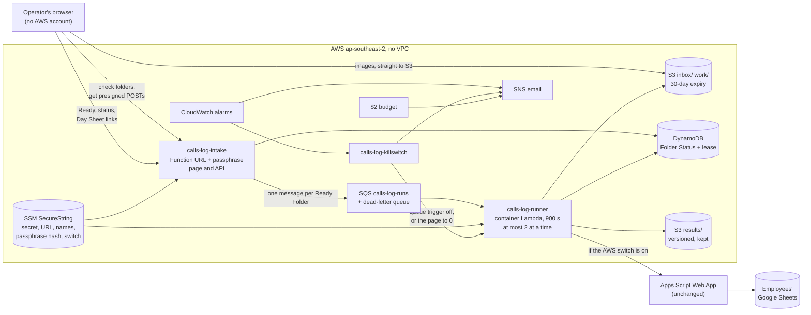

# Architecture: Route B, a serverless queue around an unchanged pipeline

## The shape

The existing pipeline (preprocess, OCR, parse, sessions, workbook, sync) is
the frozen core. Everything AWS-specific is an adapter in `cloud/` that calls
into it; the core never imports `cloud/`, and a test enforces that. The PC
keeps running the same core, so both sides produce the same sessions.

## One Folder's path

1. **Check.** The page checks each folder (name and real date, a registered
   employee, 1 to 50 images, no HEIC-only, at most 15 MB each), and the server
   checks again with the same parser the runner uses.
2. **Upload.** The server writes the Folder Status item (Uploading) and returns
   one presigned POST per image, for its exact key and type. The browser sends
   the images straight to S3; the page never holds an AWS credential.
3. **Ready.** The server counts what arrived. All of it: Pending, and one SQS
   message. Fewer: refused, nothing processed, the leftovers expire.
4. **Run.** The runner takes the Person-Day's lease, counts the attempt, OCRs
   each image in the PC's sort order (checkpointing each), builds the sessions,
   stores the Day Sheet as a new version in `results/`, syncs it if the AWS
   switch is on, and marks the Folder Done. A failure returns the message; the
   fourth start parks the Folder and emails the Owner.

## Fences

- **Identity.** GitHub Actions signs in through OIDC to two roles: a deploy
  role trusted only from `main`, and a read-only plan role for pull requests.
  No access key exists anywhere. Both roles, and every right the deploy role
  has, live in a bootstrap a person applies after reading its plan ([ADR 7](adr/0007-hand-applied-bootstrap-and-role-fence.md)).
- **Function roles.** Each function's role must sit under `/calls-log/` with a
  permissions boundary; the deploy role can create no other kind and pass them
  only to Lambda. So a merged commit can't mint a role that reaches beyond this
  project.
- **Data.** Account-wide Block Public Access, SSE-S3, TLS-only bucket policy,
  ACLs off, versioned Day Sheets, 30-day expiry for screenshots. Secrets stay
  out of the repo, the image and the Terraform state ([ADR 8](adr/0008-secrets-out-of-terraform-state.md)).
- **The public page.** A passphrase checked against a PBKDF2 hash before any
  data call, a CSP that allows only the page's own blocks, CORS for its own
  origin only, and two alarms that switch it off if it is flooded.

## Cost model

Every resource is pay-per-use; nothing carries a fixed monthly fee (no NAT,
load balancer, VPC endpoint, KMS key or domain). The planning estimate is
**about $0.39 a month**: the OCR runs inside Lambda's always-free 400,000 GB-s,
and the rest is ECR storage and S3. The $2 is defended in layers ([ADR 3](adr/0003-cost-guardrails-in-infrastructure.md)):
at most two Runs at a time, a kill switch on three runner alarms (worst case
$0.48 past the free tier before it acts), two page alarms, budget emails at
50/80/100%, and the account's own spend limit as the last resort. Story 3.1
measures the real GB-s per image; Story 6.2 reports the real bill.

## Delivery

One Terraform root module with state in S3 (`use_lockfile`). A pull request
gets a posted plan from the read-only role. A merge with green CI builds the
image, runs the unit tests inside it, pushes it tagged with the commit SHA,
applies with that tag, and then checks that a fresh plan shows no drift. CI also
fails closed on private data, and proves on made-up screenshots that the image
reads them exactly as the PC does.
