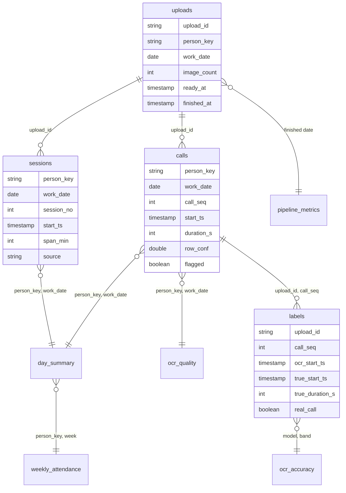

# Data contract: the call-log data lake

`schema_version = 1`. Decision: [ADR 9](adr/0009-call-rows-in-an-s3-data-lake.md).
Code: `cloud/lake.py` builds and checks the envelope. `tests.py` fails if this
page's column lists or flag codes differ from that module.

The lake is additive: the Day Sheet and the Google Sheet stay the Owner's
record. No name, phone number, OCR text, file name or secret enters it.

## Where things live

| Prefix | What | Kept |
|---|---|---|
| `staging/<Person-Day>/<uploadId>.json` | One Done upload's envelope, written by the runner while `/calls-log/lake_enabled` is `true` | 30 days |
| `lake/<table>/work_month=YYYY-MM/<person_key>_<yyyy-mm-dd>.parquet` | The publisher's Parquet, one file per person, day and table, overwritten by a Re-run | Permanent |
| `lake/labels/work_month=YYYY-MM/<batch>.parquet` | Hand labels, one file per labelling batch and month, written by `tools/label_calls.py import` (re-importing a batch replaces it) | Permanent |
| `quarantine/<Person-Day>/<uploadId>.json` | An envelope that failed a check: `{"problems": [...], "envelope": {...}}` | 30 days |
| `athena-results/` | Athena's query results (workgroup `calls-log`) | 7 days |

Only the staging key holds the Person-Day, the same way `results/` does. The
envelope itself has none.

## The envelope (staging JSON)

| Key | Content |
|---|---|
| `schema_version` | `1` |
| `person_key`, `work_date`, `upload_id` | The same values as on every row |
| `staged_at` | When the runner wrote it, UTC `yyyy-mm-ddTHH:MM:SSZ` |
| `day_sheet` | `{"sessions": n, "span_min": total}`, read back from the stored Day Sheet (rows 7 to 22, B2's total) with the PC's own reader |
| `calls`, `sessions`, `uploads` | Lists of rows, columns exactly as below, in this order |

The runner stages only Done uploads, after Folder Status says Done. The
publisher also drops an envelope whose upload is no longer Done or the day's
choice (Held, Superseded, or chosen later), so only the day's current choice
reaches the lake.

Local times (`start_ts`, `end_ts`) are phone wall-clock times on the work
date, with no time zone, written `yyyy-mm-ddTHH:MM:00`. An end before its
start moves to the next day. Pipeline times (`ready_at`, `started_at`,
`finished_at`) are UTC, as Folder Status writes them.

### `calls`

One row per call the pipeline read: the records left after `dedupe`, in the
order it kept them, without rows that have no start time.

| Column | Type | Null | Meaning |
|---|---|---|---|
| `person_key` | string | no | HMAC-SHA256 under `/calls-log/person_salt` of the folded NAME_TO_ID key the Web App picks for the name (the folded name if none matches), first 16 hex digits |
| `work_date` | date | no | The Person-Day's date |
| `upload_id` | string | no | The uploadId, `yyyymmddTHHMMSSZ-<8 hex>` |
| `image_key` | string | no | The image's position in the PC's order, `01`, `02`, …; `pc_order` over `inbox/<uploadId>/` gives the file back while it exists |
| `call_seq` | int | no | 1, 2, … in kept order |
| `start_ts` | timestamp | no | Start, local |
| `end_ts` | timestamp | yes | Start plus the rounded minutes; null when there is no duration (a missed call) |
| `duration_s` | int | yes | Seconds read from the screenshot; 0 for a 0-second or recovered call; null for a missed call |
| `direction` | string | no | `incoming`, `outgoing` or `unknown` |
| `call_status` | string | no | `answered`, `missed`, `unanswered`, `zero_duration` or `unknown` |
| `countable` | boolean | no | Counted toward sessions |
| `row_conf` | double | no | Mean OCR confidence of the row's lines (the value the 0.85 threshold is applied to) |
| `start_conf` | double | yes | Confidence of the OCR line the start time came from (the lowest, if it spans lines) |
| `duration_conf` | double | yes | The same for the duration; null when none was read |
| `flagged` | boolean | no | The parser wanted a review, or a confidence is under 0.85 |
| `flag_field` | string | yes | `start`, `duration`, `direction` or `row`; null when not flagged |
| `flag_reason` | string | yes | One code from the list below; null when not flagged |
| `parser_version` | string | no | sha256 of `parser.py`, `session_builder.py` and `config.py` (line endings folded), first 12 hex digits |
| `ocr_model` | string | no | `<engine>:<detector>/<recogniser>` from `config.py` |
| `ingested_at` | timestamp | no | Added by the publisher, UTC |

### `sessions`

One row per Day Sheet row (7 to 22), as `build_sessions` made it.

| Column | Type | Null | Meaning |
|---|---|---|---|
| `person_key` | string | no | As in `calls` |
| `work_date` | date | no | As in `calls` |
| `upload_id` | string | no | As in `calls` |
| `session_no` | int | no | Column A: 1, 2, … |
| `start_ts` | timestamp | no | Column B, local |
| `end_ts` | timestamp | no | Column C, local |
| `span_min` | int | no | Column D in minutes; B2 is their sum |
| `call_count` | int | yes | Countable calls merged into it; null for `xlsx_backfill` rows (a Day Sheet doesn't record it) |
| `source` | string | no | `runner`; `xlsx_backfill` for rows read from stored Day Sheets (`tools/backfill_lake.py`) |
| `ingested_at` | timestamp | no | Added by the publisher, UTC |

### `uploads`

One row per staged upload: how the Run went.

| Column | Type | Null | Meaning |
|---|---|---|---|
| `upload_id` | string | no | As in `calls` |
| `person_key` | string | no | As in `calls` |
| `work_date` | date | no | As in `calls` |
| `image_count` | int | no | Images in the upload |
| `attempts` | int | no | Runs started, this one included |
| `ready_at` | timestamp | yes | When it was made Ready or last re-queued, UTC (the start of the turnaround) |
| `started_at` | timestamp | yes | When this Run started, UTC |
| `finished_at` | timestamp | yes | When it was marked Done, UTC |
| `status` | string | no | `Done` |
| `runner_memory_mb` | int | yes | The Lambda's memory; null outside Lambda |

### `labels`

Hand labels for OCR accuracy (Phase 4.5). They aren't in the envelope: the
Owner samples calls with `tools/label_calls.py sample`, reads each one off its
screenshot, and imports the worksheet. Each label keeps a copy of what the OCR
read, so it stays meaningful after a Re-run replaces the call.

| Column | Type | Null | Meaning |
|---|---|---|---|
| `person_key` | string | no | As in `calls` |
| `work_date` | date | no | As in `calls` |
| `upload_id` | string | no | The upload the labelled call came from |
| `image_key` | string | no | As in `calls` |
| `call_seq` | int | no | As in `calls`; with `upload_id`, the call |
| `ocr_start_ts` | timestamp | no | The call's `start_ts` when it was sampled |
| `ocr_duration_s` | int | yes | Its `duration_s` |
| `row_conf` | double | no | Its `row_conf` |
| `start_conf` | double | yes | Its `start_conf` |
| `duration_conf` | double | yes | Its `duration_conf` |
| `flagged` | boolean | no | Its `flagged` |
| `parser_version` | string | no | Its `parser_version` |
| `ocr_model` | string | no | Its `ocr_model` |
| `real_call` | boolean | no | False when the OCR's row isn't a call at all |
| `true_start_ts` | timestamp | yes | The start as read off the screen, local; null when not a call |
| `true_duration_s` | int | yes | The duration as read off the screen, 0 for a missed call; null when not a call |
| `batch` | string | no | The sample, `labels-yyyymmddTHHMMSSZ` |
| `labelled_at` | timestamp | no | When the worksheet was imported, UTC |

## Flag codes

`flag_reason` holds a code, never a message: a warning such as
`possible_fuzzy_duplicate_with_<file>@<time>` is cut down to its code. The
reason is the parser's first warning that isn't informational; otherwise a
low field confidence, a low row confidence, or not countable.

| Field | Codes |
|---|---|
| `start` | `start_time_not_found`, `multiple_time_candidates`, `ampm_missing_shifted_to_pm`, `ampm_missing_assumed_24h`, `hour_out_of_range`, `unknown_ampm_marker` |
| `duration` | `duration_not_found`, `duration_format_ambiguous_assumed_mm_ss`, `duration_missing_assumed_zero`, `duration_missing_assumed_zero_for_outgoing` |
| `direction` | `direction_conflicting_keywords`, `direction_unknown_for_missed_or_zero`, `direction_unknown_assumed_countable`, `direction_and_status_unknown`, `recovered_without_call_marker` |
| `row` | `call_appears_to_cross_midnight`, `possible_fuzzy_duplicate`, `low_ocr_confidence`, `status_bar_row_ignored`, `promo_row_ignored`, `status_bar_region_row_ignored` |
| added by the emitter | `low_field_confidence` (with `start` or `duration`), `not_countable`, `other` (a warning this list doesn't know yet) |

## Quality checks

`lake.check()` returns what is wrong with an envelope, naming rows by position
only. The publisher writes nothing from an envelope with any problem: it goes
to `quarantine/`, a metric counts it, and `calls-log-alerts` emails.

- The envelope keys and every row's columns are exactly the ones above, and
  `person_key`, `work_date` and `upload_id` agree everywhere.
- Calls: `start_ts <= end_ts`, which is `<=` and not `<` because a 0-second
  call ends the minute it starts. `end_ts - start_ts` is within 1 minute of
  `duration_s`. A countable call has an `end_ts`. Confidences lie in 0..1, and
  the flag columns agree with each other.
- Sessions: numbered 1..n, at least one call each, `span_min` equal to
  `end_ts - start_ts`, sorted, no overlaps. A session that crosses midnight
  fails on purpose: its Day Sheet span is negative.
- The sessions' `call_count` adds up to the countable calls. This holds while
  `drop_standalone_zero_sessions` is off, as it is now.
- The sessions match `day_sheet`: the same number of rows, and `span_min` adds
  up to B2.
- No more than 30% of calls have `row_conf` under 0.85. This is a starting
  value; Phase 4.5 calibrates it on real days.
- One `uploads` row: Done, with images and an attempt.

## The publisher

`cloud/publisher.py`, the `calls-log-publisher` function (`infra/lake.tf`). S3
calls it for each new `staging/*.json`. For each envelope:

1. It reads the upload in Folder Status. Unless the upload is Done and still
   the day's choice, it drops the envelope.
2. It runs `lake.check()`, and checks that `upload_id` and `work_date` match
   the staged key. If anything fails, it writes the envelope and its problems
   to `quarantine/`.
3. Otherwise it writes the three tables as Parquet (snappy) to their fixed
   keys, adding `ingested_at`. A Re-run, or a replay of the same envelope,
   overwrites the same three files.

Each envelope gives one JSON log line in CloudWatch's Embedded Metric Format.
It counts `Published`, `Dropped` and `Quarantined` in the namespace
`calls-log/lake` (dimension `Function = calls-log-publisher`), with the uploadId, the reason and the problems by position:
never a name or a row. `calls-log-lake-quarantined` emails on any quarantine.
`calls-log-publisher-errors` emails when an envelope fails outright; S3 retries
it twice first. Neither alarm calls the kill switch.

Parquet types follow `lake.COLUMN_TYPES`: `string`, `date` (date32), `int`
(int32), `double`, `boolean`, and `timestamp` (milliseconds, no time zone).
CI writes a made-up day and reads it back against the Glue columns
(`tools/check_lake_parquet.py`).

## Querying (Athena)

Database `calls_log`, tables `calls`, `sessions`, `uploads` and `labels`, workgroup
`calls-log`. The workgroup enforces its settings: a query stops after 100 MB
scanned, and its results go to `athena-results/` for 7 days. `work_month`
(`yyyy-MM`) is a projected partition, so filter on it to read one month:

```sql
SELECT person_key, work_date, sum(span_min) / 60.0 AS hours
FROM calls_log.sessions
WHERE work_month = '2026-10'
GROUP BY 1, 2
ORDER BY 2, 1;
```

## History from stored Day Sheets (backfill)

`tools/backfill_lake.py` runs once from CloudShell. For each current
`results/<Person-Day>.xlsx` it finds the day's chosen Done upload in Folder
Status (made Ready last; a PC import counts only when nothing else is Done),
reads the sheet's session rows with the PC's own reader, and writes:

- `sessions` rows with `source = 'xlsx_backfill'` and `call_count` null;
- the `uploads` row when the upload was a Run (a PC import has no times), with
  `runner_memory_mb` null;
- no `calls` rows: a Day Sheet doesn't hold them.

It writes to the publisher's fixed keys, and only where no file exists yet. A
day the publisher already wrote keeps its richer rows, and a later Re-run's
publish replaces a backfilled file. Rows pass the same session checks
(numbered, start before end, `span_min` agreeing, sorted, no overlap); a day
that fails is skipped and reported by person_key, never by name.

## Views

Plain SQL in `sql/views/`, created in the `calls_log` database by
`tools/lake_views.py` (in this order, since `weekly_attendance` reads
`day_summary`). CI runs them, and every `sql/examples/` query, on DuckDB over
real Parquet (`tools/check_lake_views.py`).

| View | One row per | Columns |
|---|---|---|
| `day_summary` | person and day | `work_month`, `person_key`, `work_date`, `source`, `sessions`, `span_min`, `hours`, `first_start`, `last_end`, `calls`, `countable_calls`, `flagged_calls` (the last three null for backfilled days) |
| `weekly_attendance` | person and week (from Monday) | `person_key`, `week_start`, `days_worked`, `span_min`, `hours`, `avg_hours_per_day` |
| `pipeline_metrics` | day a Run finished | `finished_date`, `uploads`, `images`, `retried`, `turnaround_p50_s`, `turnaround_p95_s`, `run_p50_s`, `est_gb_s`, `est_gb_s_per_image` (GB-s are estimates: Run seconds × memory; a resumed Run counts its last start only) |
| `ocr_quality` | day, person, model and parser version | `work_month`, `work_date`, `person_key`, `ocr_model`, `parser_version`, `calls`, `flagged`, `low_row_conf`, `low_start_conf`, `low_duration_conf`, `mean_row_conf`, `min_start_conf`, `min_duration_conf` (the label-free half of OCR accuracy) |
| `ocr_accuracy` | model, parser version and confidence band | `ocr_model`, `parser_version`, `conf_band` (`high` at or over 0.85, `low`, `unknown`), `labelled`, `not_a_call`, `calls`, `start_exact`, `duration_exact`, `both_exact`, `start_exact_rate`, `duration_exact_rate`, `duration_mean_error_s` (the labelled half: a start must match to the minute, a duration to the second; a call labelled twice counts once, by its latest label; calls the OCR missed altogether aren't measured) |



## Changing the contract

A new, renamed or retyped envelope column bumps `schema_version` (`labels`
isn't in the envelope, so its columns don't), and any column change is made in this
page, `cloud/lake.py` (`COLUMN_TYPES`) and the Glue tables (`infra/lake.tf`)
in the same pull request; tests compare all three. The
publisher refuses any version it doesn't know. A new warning in the parser
needs its code added above, or it arrives as `other`; a test lists the
parser's warnings and fails until it is added.
